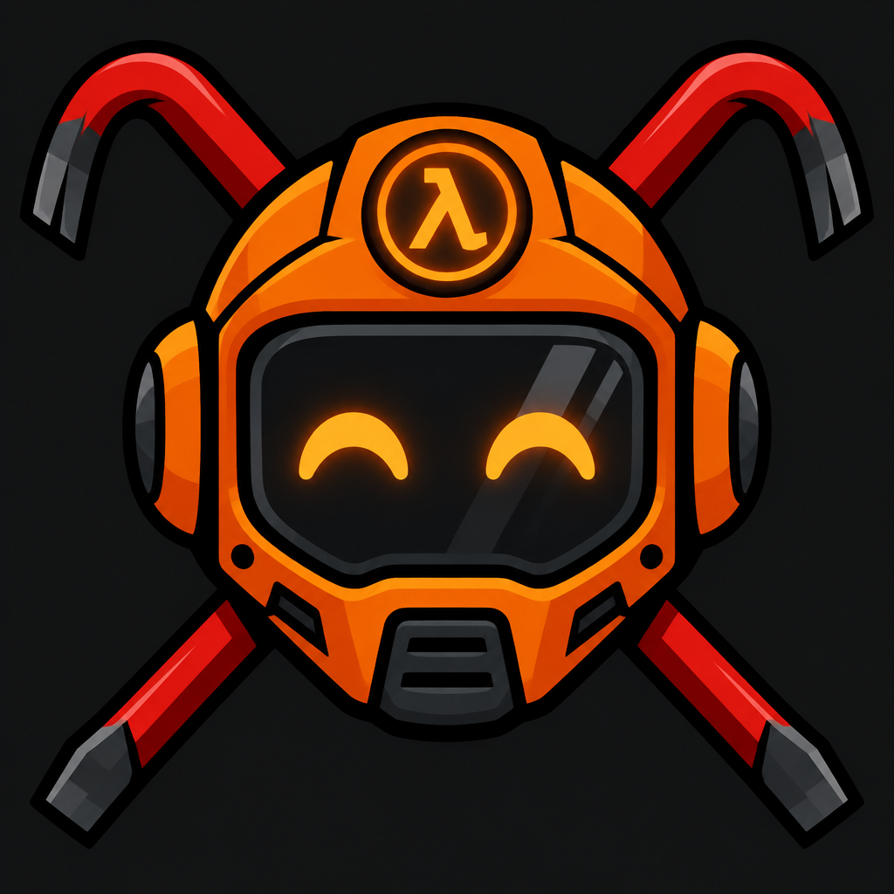

  

<h1 align="center">🤖 Crowbot</h1>

  <b>Smart, drop-in deathmatch bots for Half-Life 1. No waypoint files needed.</b>

  
  
  
  

Crowbot is a Metamod plugin that fills your **Half-Life Deathmatch** server with computer-controlled players. 🎮
Add a few with one command and they will hunt, loot and frag like a lively lobby.

## ✨ Features

- 🧭 **Waypoint-free navigation:** hull-trace probing avoids walls, ledges and lava, and jumps low obstacles
- 🎒 **Loot hunters:** go after weapons, ammo, health and armor, and drop targets they can't reach
- 🔫 **Weapon smarts:** pick weapons by range, and lead rockets and crossbow bolts
- 🎯 **Human-like aim:** reaction delay, aim error and smoothed turning that scale with skill 1-5
- 💨 **Strafing and jumping** in fights
- 🛡️ **Respawn and quota management:** keeps the bot count at a number you set
- 👥 **Teamplay support:** bots join the smallest team
- 🐛 **Debug mode:** per-bot movement stats

## 🚀 Quick start

1. Install [Metamod-r](https://github.com/theAsmodai/metamod-r) on your HLDS server.
2. Drop `crowbot.dll` into `valve\addons\crowbot\`.
3. Add `win32 addons/crowbot/crowbot.dll` to `valve\addons\metamod\plugins.ini`.
4. In `server.cfg` set `crowbot_quota 4`, then start the server and join. 🎉

## 🔨 Build

Requires MSVC Build Tools (x86). Half-Life is 32-bit.

    scripts\fetch-deps.ps1   -> downloads HLSDK/Metamod headers into include\ (first time only)
    build.bat                -> build\crowbot.dll

## 📦 Install

1. Install [Metamod-r](https://github.com/theAsmodai/metamod-r) so `liblist.gam` has
   `gamedll "addons\metamod\dlls\metamod.dll"`.
2. Copy `build\crowbot.dll` to `valve\addons\crowbot\crowbot.dll`.
3. Add `win32 addons/crowbot/crowbot.dll` to `valve\addons\metamod\plugins.ini`.

## 🎛️ Commands and cvars

Server console (or the in-game console of a listen-server host):

    crowbot add [skill]    add one bot
    crowbot kick           remove one bot
    crowbot kickall        remove all bots and set quota 0
    crowbot quota <n>      keep n bots in the game
    crowbot skill <1-5>    default skill for new bots

| cvar | default | meaning |
|------|---------|---------|
| crowbot_quota | 0 | desired number of bots |
| crowbot_skill | 3 | 1 (easy) to 5 (hard): aim error, reaction and turn speed |
| crowbot_debug | 0 | print per-bot movement stats every 5s |

## 🧪 Testing locally

`scripts\test-server.ps1` rebuilds, restarts a test HLDS under `deps\hlds` (installed with SteamCMD,
`app_update 90 -beta steam_legacy`, with Metamod-r installed) and prints bot activity.

## 🧠 How it works

Bots are *fake clients*: the plugin creates them with the engine's `pfnCreateFakeClient`, and each server frame
feeds them input through `pfnRunPlayerMove`, just like a real player's client would. They run inside the server
process, so there is no separate binary or network connection. They do take up `maxplayers` slots.

## ⚠️ Known limitations

- No waypoints/navmesh, so bots can get lost on complex maps.
- Ammo is not tracked; empty weapons are detected when selection fails.
- Grenades, satchels, tripmines and snarks are not used.

## 🗺️ Roadmap

See [TODO.md](TODO.md) for what's planned: pathfinding, bot chat, admin commands, a Linux build and more.

## 📄 License

MIT, see [LICENSE](LICENSE). The HLSDK and Metamod-r headers fetched into `include\` are not part of this repo and
are covered by their own licenses.
